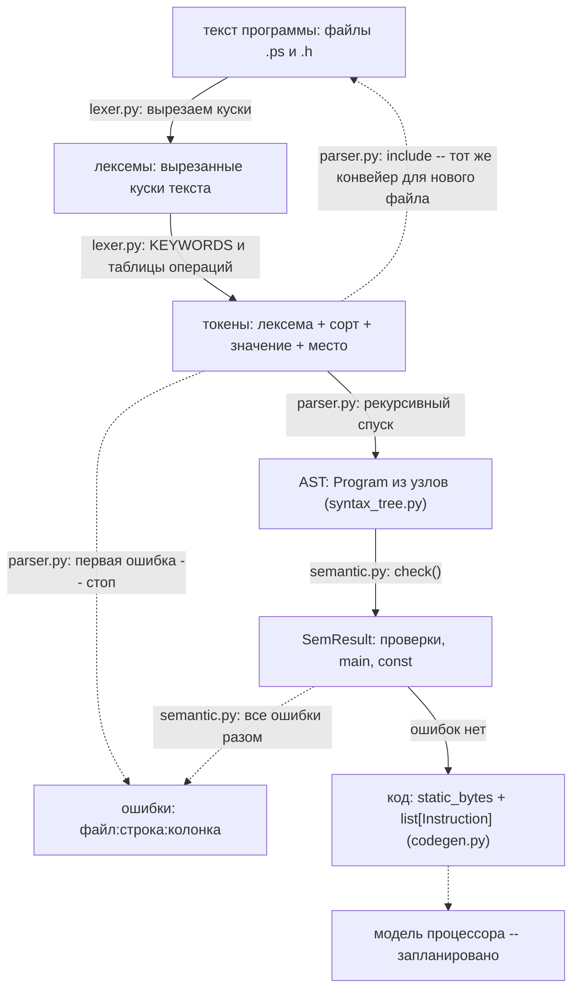
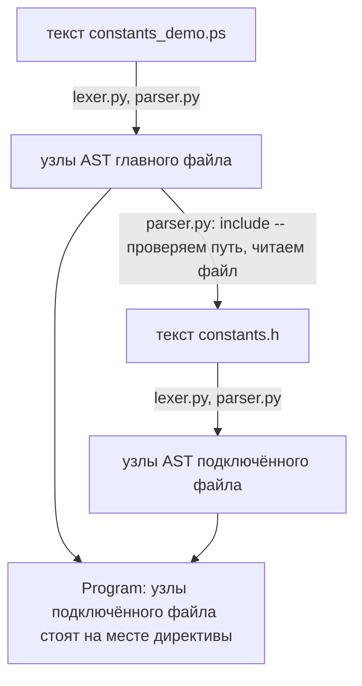
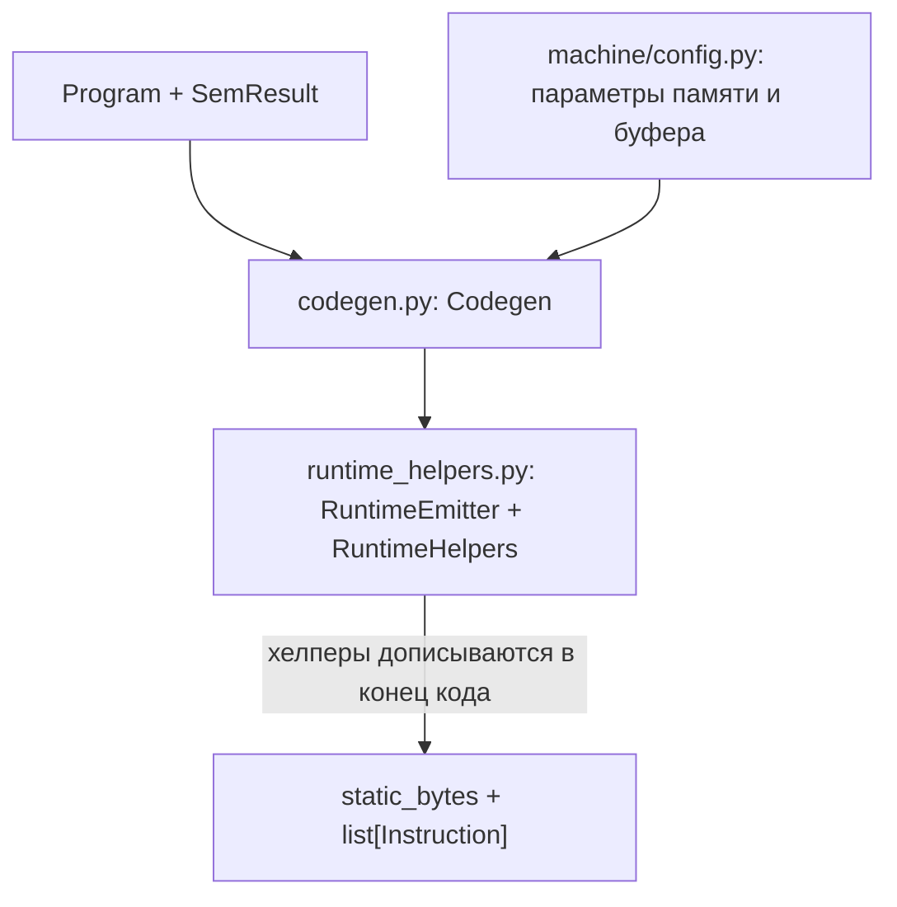

# Архитектура PuginScript

Транслятор -- конвейер, и каждый этап -- отдельный модуль в `src/translator`. Сначала `lexer.py` режет текст программы на лексемы-токены, затем `parser.py` разбирает список токенов и собирает дерево программы -- AST из узлов `syntax_tree.py`, в конце `semantic.py` проверяет дерево и собирает ошибки, после чего `codegen.py` выпускает из проверенного дерева инструкции ISA. Include встроен в этот конвейер: директиву обрабатывает сам парсер, запуская лексер заново для каждого подключённого файла. Правила языка -- в [документации](LANGUAGE.md), описание команд -- в [спецификации ISA](ISA.md)

## Общая схема


Пунктир показывает нелинейности. Парсер при первой же ошибке завершает трансляцию, а семантика копит все и отдаёт разом -- два разных пунктира в один узел ошибок. Обратная пунктирная стрелка от токенов -- include: парсер подтягивает текст нового файла и запускает для него тот же конвейер

Точки входа этапов: `lex(text, file_name) -> list[Token]`, `parse(file_path) -> Program`, `check(program) -> SemResult`, `codegen(program, result) -> (static_bytes, code_instructions)`, печать дерева -- `dump(program) -> str`. Единого драйвера нет: этапы вызывают вручную

## lexer.py: лексер

Читает текст ровно одного файла и режет его на токены: ключевые слова, идентификаторы, числа, строки и символы с escape-последовательностями, знаки операций. Комментарии `//` и `/* */` выбрасываются на этом этапе. Каждый токен несёт лексему, сорт, значение и место в исходнике -- `SourceLocation(file, line, column)`: на этой координате строятся все сообщения об ошибках дальше по конвейеру. Первая ошибка лексера завершает трансляцию

## parser.py: парсер

Рекурсивный спуск по грамматике: парсер идёт по списку токенов и строит AST из классов `syntax_tree.py` (`Program`, `FunctionDecl`, `IfStmt`, `Binary`, ...). Точка входа `parse(file_path)` читает файл и запускает лексер; `parse_text(text, file_name)` разбирает уже готовый текст. Синтаксическая ошибка останавливает разбор на первой

Глубина вложенности (скобки в выражениях и вложенные блоки считаются вместе) ограничена константой `MAX_PARSE_DEPTH = 64`. Расчёт такой: рекурсивный спуск держит на каждый уровень живую цепочку из ~12 кадров Python (от `_expression` до `_primary` через ярусы приоритета операторов), итого 64 * 12 = ~770 кадров. У Python по умолчанию лимит стека вызовов -- 1000 кадров, превышение роняет программу с голым `RecursionError`, поэтому собственный лимит срабатывает первым и превращает слишком глубокую вложенность в обычную `TranslatorError` с локацией. Страховочный `except RecursionError` в `parse`/`parse_text` -- на случай, если интерпретатор всё же доберётся до своего лимита раньше. Число 12 приближенное: между уровнями мелькают переходящие кадры (`_peek`, конструкторы узлов), а константа слегка меняется от версии к версии Python -- в этом расчёте важен запас, а не точность.

Порог 64 выбран не с потолка: стандарт C11 (п. 5.2.4.1) требует от транслятора поддерживать всего 63 уровня вложенных скобок, так что PuginScript принимает выражения минимум на один уровень глубже, чем гарантирует C, -- единственное поле, на котором мы объективно круче C (выбирайте PuginScript)

```python
def parse(file_path: str) -> Program:
    path = os.path.normcase(os.path.abspath(file_path))
    text = _read_source(path, SourceLocation(file_path, 1, 0))
    included = {path}
    try:
        return _FileParser(lex(text, path), path, included).parse_program()
    except RecursionError:
        raise TranslatorError(
            SourceLocation(file_path, 1, 0),
            f"превышена максимальная глубина вложенности ({MAX_PARSE_DEPTH})",
        ) from None
```

## include: единственный поворот конвейера

include -- часть грамматики, поэтому обрабатывает его сам парсер. Увидев директиву, он проверяет путь, читает новый файл и запускает для него тот же конвейер: лексер, затем разбор. Узлы подключённого файла встают на место директивы в общий `Program`, и разбор продолжается. Отдельного препроцессора с текстовой склейкой нет, поэтому ошибка внутри `.h` честно указывает на этот `.h`


Проверки пути в `_include()`: не пустой, без NUL-символа, не абсолютный и без диска (`os.path.isabs`, `os.path.splitdrive`), без `..`, расширение только `.ps` или `.h`. Повторное включение и циклы отсекаются множеством уже включённых путей после `os.path.normcase(os.path.abspath(...))`. Рекурсивный хвост (`src/translator/parser.py`):
```python
self._included.add(target)
text = _read_source(target, path_token.location)
nested = _FileParser(lex(text, target), target, self._included)
return nested.parse_program().items
```

## syntax_tree.py: узлы дерева

Модуль данных, а не процесса: `@dataclass`-классы всех узлов AST (`Program`, `FunctionDecl`, `VarDecl`, `Binary`, ...), у каждого узла есть `location`. Эти классы заполняет парсер и читает семантика. Здесь же `dump(program) -> str` -- печать дерева в форме S-выражений, удобно смотреть на разбор руками

## semantic.py: семантика

Семантическая проверка проходит по готовому дереву в несколько этапов: сначала объявляются `const` и функции, затем проверяется верхний уровень, после этого -- тела функций. Проверяются имена и области видимости, типы выражений и вызовов, чтение переменных только после инициализации, `return` на всех путях у функций с типом, наличие и единственность `main`, вычисление compile-time-констант. В отличие от лексера и парсера, ошибки не останавливают проверку: они копятся в `SemResult.errors` и выводятся все разом
```python
def check(program: Program) -> SemResult:
    return _Checker().run(program)
```

## codegen.py: кодоген

Кодогенерация идёт по уже проверенному дереву: `codegen(program, result)` принимает `Program` и `SemResult` и возвращает `(static_bytes, code_instructions)` -- байтовый образ секции данных и список инструкций для памяти команд. При семантических ошибках генерация не запускается, поэтому кодоген не повторяет проверки типов. Вместо этого он выпускает проверки времени исполнения, которые семантика сделать не может: границы массива, переполнение в `input_int`, размер и переполнение кучи в `new` -- всё это условные переходы на `trap`

Соглашение о регистрах то же, что в [спецификации ISA](ISA.md): `R0` -- ноль, `R1` -- RA, `R2` -- SP, `R3` -- FP, `R4-R7` -- аргументы и результат, `R8` -- HP, `R9-R31` -- временные. Локальные переменные лежат в кадре со смещениями от `FP`, вызов -- `jal`, возврат -- `jr R1`

Прогон `generate()`:
- `_layout_static()` предварительно добавляет литералы и значения констант в секцию данных
- стартовая заглушка резервирует команду инициализации `HP`; в конце она получает размер статики, затем вызывается `main` или скрипт верхнего уровня и выполняется `halt`
- `_compile_function()` и `_compile_script()` назначают локальным переменным слоты в кадре и генерируют тела функций или верхнеуровневый скрипт
- `_emit_runtime_helpers()` добавляет подпрограммы времени выполнения в конец списка инструкций
- `_patch_labels()` заменяет метки на относительные смещения
- размер статики ограничен `MAX_STATIC_SIZE` из `src/machine/config.py` (32764 байта)

Временные регистры `R9-R31` раздаются из пула и освобождаются после использования, поэтому вложенные выражения используют общий пул

Ядро кодогенератора -- `Codegen` в [codegen.py](../src/translator/codegen.py). Подпрограммы времени выполнения (печать значений, ввод, работа со строками) вынесены в [runtime_helpers.py](../src/translator/runtime_helpers.py): `RuntimeEmitter` порождает инструкции через состояние основного кодогенератора, а `RuntimeHelpers` ведёт реестр хелперов -- кодоген помечает, какие понадобились, и `_emit_runtime_helpers()` дописывает их в конец кода. Номера регистров объявлены рядом с `Codegen`. Параметры, общие для транслятора и будущей модели процессора, находятся в [config.py](../src/machine/config.py): размер RAM, максимальный размер статики и размер буфера `input()`. Кодогенератор использует размер RAM для ограничения размера динамического массива, а размер буфера и лимит статики -- непосредственно при генерации

`new int[n]` генерирует цикл записи нулей в элементы только что выделенного массива. Неинициализированные локальные слоты также получают технический ноль, но семантика запрещает читать переменную до первого присваивания. Неиспользуемая память RAM при старте не очищается. Литералы массивов выделяются без цикла обнуления, поскольку их значения записываются сразу после выделения.


## Реальный прогон

Файлы из [examples/](../examples/) используются и как примеры, и как входы golden-тестов: ожидаемое AST каждого примера хранится S-выражением в [tests/frontend/golden/ast/](../tests/frontend/golden/ast/).

Токены `examples/constants_demo.ps`, который подключает `examples/constants.h` строкой `include "constants.h";`:
```text
CONST    'const'      @ constants.h:1:0
INT      'int'        @ constants.h:1:6
IDENT    'min_s'      @ constants.h:1:10
ASSIGN   '='          @ constants.h:1:16
```

Элементы подключённого файла стоят в `Program` на месте директивы, вывод `dump()`:
```text
(program
  (const int min_s 60)
  (const int hour_s (* 60 (identifier min_s)))
  (const int day_s (* 24 (identifier hour_s)))
  (def main
    (returns int)
    ...
```

Ошибка внутри включённого файла ссылается на его собственную локацию:
```text
tmp_inc\lib.h:2:16: ожидалось выражение, найдено ';'
```

## Ошибки

- Лексер и парсер: первая `TranslatorError` завершает трансляцию, формат сообщения `файл:строка:колонка: текст`
- Семантика: ошибки собираются в `SemResult.errors` и выводятся все разом
- Кодоген: первая `CodegenError` завершает генерацию, при семантических ошибках он не запускается
- Повторное включение файла, включая циклы, -- ошибка компиляции

## Запланированные этапы

- Вывод листинга и бинарного `.bin` из `(static_bytes, code_instructions)`
- CLI `ps` как единый драйвер: `parse -> check -> codegen`
- Модель процессора: DataPath, микропрограммный CU, конвейер, ввод-вывод через PMIO, загрузка `.bin`
- Детальную схему процессора нарисуем после фиксации ISA: пока любое кодирование и такты были бы догадками
